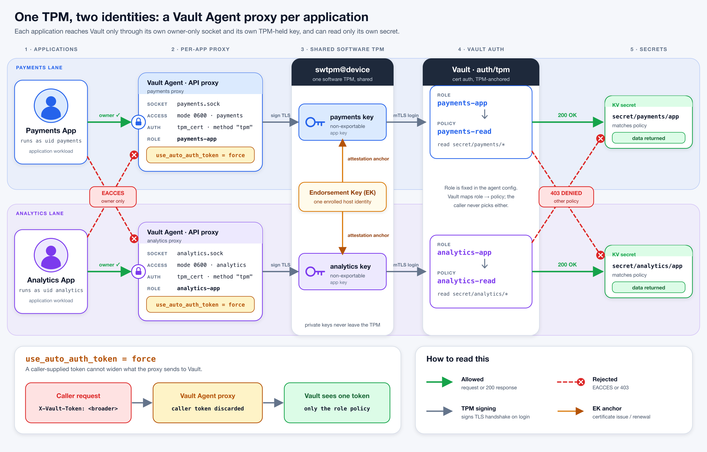

# Vault TPM Authentication Lab

A self-contained Vault Enterprise lab showing three progressively stronger TPM-backed
workflows:

1. A machine logs in directly with `vault login -method=tpm`.
2. One workload uses a normal localhost URL while Vault Agent performs TPM
   authentication and manages its token.
3. Payments and analytics workloads use separate, owner-only Unix sockets, fixed roles
   and TPM-backed application keys.

The original generic `auth/cert` flow remains available as `task demo:bonus`. It shows
an OpenSSL client using a TPM-held TLS key, manual token handling, negative tests and
the reason one shared device certificate cannot isolate local applications.



## Demo workflows

### 1. Direct machine login

`task demo:cli` prints and runs native `vault tpm attest` and
`vault login -method=tpm` commands. The CLI receives a `device-read` token, reads the
device secret and revokes the demonstration token.

### 2. One workload through a standard URL

`task demo:proxy` starts Vault Agent at `http://127.0.0.1:8100`. The application sends
ordinary Vault requests while Agent performs TPM authentication, renewal and token
injection. This workflow demonstrates token automation, not local process isolation.

### 3. Multiple isolated workloads

`task demo:multi-app` gives payments and analytics separate role-fixed agents and
owner-only Unix sockets. Each application reads its own secret; cross-socket access,
cross-secret access and caller-supplied broader tokens are rejected.

See [`docs/demo-output.txt`](docs/demo-output.txt) for a complete captured run without
setting up the VM.

## Prerequisites

Everything runs on a macOS host driving an Ubuntu 24.04 VM via Multipass.

Vault TPM authentication requires Vault Enterprise `2.2.0-rc1+ent`. Put the Enterprise
licence at `.vault-license` before running `task all`.

| Tool | Why |
|---|---|
| `multipass` | hosts the lab VM — required |
| `task` ([go-task](https://taskfile.dev)) | runs everything — required |
| `jq` | parses Vault JSON — required |
| `git` | required |
| `graphviz`, `librsvg` | optional — only to re-render diagrams with `task docs:diagram` |
| `shellcheck`, `gitleaks`, `pre-commit` | optional — only for `task lint` |

```bash
brew install --cask multipass
brew install go-task jq graphviz librsvg shellcheck gitleaks pre-commit
```

## Quick start

```bash
task deps    # verify host tooling
task init    # one-time project setup (pre-commit hooks, .env)
task all     # launch the VM, provision it, start the TPMs and Vault, enrol node01
task demo    # direct CLI → HTTP proxy → isolated multi-app proxies
task demo:bonus # optional generic cert-auth walkthrough and negative tests
```

`task all` takes a few minutes on first run; each of its steps is idempotent and
individually re-runnable. The multi-app workflow pauses between TPM attestations because
the TPM auth backend rate-limits certificate acquisition per endorsement key.

## All tasks

```bash
task --list
```

That is the authoritative catalogue — build steps, individual demo segments,
`task shell`, and `task logs:tpm` / `task logs:vault` for the core services.

## Documentation

[`docs/architecture.md`](docs/architecture.md) covers the topology, the enrolment and
login trust chain, what the TPM does and does not guarantee, a task-by-task walkthrough,
troubleshooting, and how the lab maps onto a production deployment.

## Reset and cleanup

```bash
task reset   # wipe lab state inside the VM, keep the VM
task clean   # delete and purge the VM entirely
task rebuild # clean, then rebuild the whole lab from scratch
```

All lab state — keys, certificates, Vault configuration — lives inside the VM. The host
holds nothing but this source tree.
